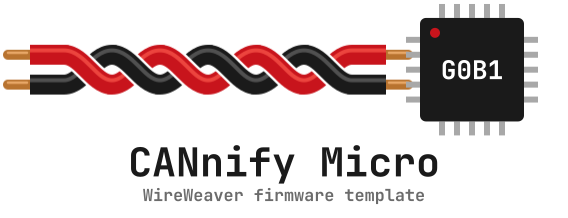
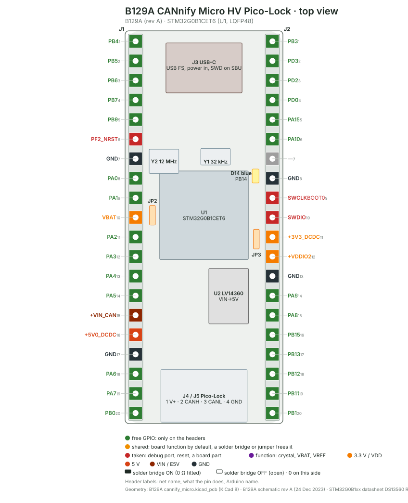

# CANnify Micro firmware template

<p align="center">
<picture>
  <source media="(prefers-color-scheme: dark)" srcset="docs/logo/logo-dark.svg">
  
</picture>
</p>

A complete, working starting point for a [WireWeaver](https://github.com/vhrdtech/wire_weaver) device on the
[B129A CANnify Micro](https://github.com/vhrdtech/hw/tree/main/b129_cannify_micro) board (STM32G0B1CE, Cortex-M0+):
firmware, a typed API, a Rust client library, a command line and a Python module, all from one API definition.
Use it as a GitHub template ("Use this template"), rename it, add your own methods, properties and streams.

The firmware was generated by the [embedded_bedrock](https://github.com/romixlab/embedded_bedrock) firmware
template and talks to the PC over the board's own USB-C (J3), which also powers it; an ST-LINK on J2 flashes it and
carries its defmt log. `bedrock_fw.json` records the generator answers; see AGENTS.md.

| directory | |
|---|---|
| `cannify_micro_api/` | `#![no_std]` API crate: the `CannifyMicroApi` trait and its data types, shared by the firmware and every host |
| `firmware/` | the firmware (embassy, defmt): `src/ww.rs` and `src/ww/device.rs` implement the API, `src/settings.rs` the settings store, `src/last_reset.rs` the crash record, `src/log.rs` the stored log, `src/boot.rs` the reboots into the ROM bootloader |
| `cannify_micro_client/` | Rust client library: typed methods over the generated WireWeaver client |
| `cannify_micro_cli/` | `cannify`, the command line over the library |
| `cannify_micro_py/` | `cannify_micro`, the Python module over the library (PyO3, maturin) |
| `scripts/rename.py` | gives the project your own name, `just rename` |

What the firmware has from the start: a WireWeaver API over USB with the device contract under `device` (firmware
name, version, commit, build id; board, unique id and chip; last reset cause with the crash record of a HardFault or
panic; a label and settings stored in flash; the `cnt` event counters in RAM and in backup registers; the defmt log,
kept in RAM across a reset; reboots into the STM32 ROM bootloader and a boot-loop rescue), a settings store in the
last 8 KiB of flash with ECC-safe reads, flip-link stack overflow protection, the ES0548 dual-bank prefetch guard.
[FEATURES.md](FEATURES.md) lists all of it with its status; [CHANGELOG.md](CHANGELOG.md) the changes.

## The board



The B129A CANnify Micro HV Pico-Lock is a one-channel CAN FD node: an STM32G0B1CET6 (LQFP48), a TCAN1044V
transceiver on FDCAN1, USB FS on a USB-C connector and two Pico-Lock connectors that carry the bus and its supply
(1 V+, 2 CANH, 3 CANL, 4 GND). Green pins on the two 1x20 headers J1 and J2 are free, red ones are the debug port,
reset and the supplies. [docs/board/](docs/board/) has the bottom view, the power tree and
[the pin table](docs/board/b129a_cannify-pins.md) with a note per pin; `just board` re-draws them from
`docs/board/b129a_cannify.toml` with [boardmap](https://github.com/romixlab/embedded_bedrock) (bedrock_board).

**Power:** from USB-C (VBUS through U4, an AOZ1376 with 5.8 V over-voltage cut-off and reverse blocking) or from the
bus's V+ on J4 / J5 (up to 53 V, F1 4 A, then the LV14360 buck to 5 V); the RT5760 makes 3.3 V from the 5 V. Either
source alone runs the board. PB2 reads VBUS through a ÷ 10.6 divider and PB10 the bus supply +VIN_CAN through ÷ 24.2
(ADC1_IN10 and IN11).

**The probe:** SWD on J2: GND J2-8, SWCLK J2-9, SWDIO J2-10, 3V3 J2-11 (the probe's target voltage); reset is J1-6.
PA14 (SWCLK) is BOOT0 as well and R28 pulls it low, so the chip boots from flash. With a USB-C debug accessory (both
CC lines pulled up), U7 routes SWD to the connector's SBU pins instead.

**CAN:** FDCAN1 TX on PD1, RX on **PB8** (the board's CubeMX file says PD0: the schematic and the board have PB8),
the transceiver's STB on PC13: low for normal mode, high or floating leaves it in standby, and there is no resistor
on it. The clock tree runs the FDCAN kernel from the 12 MHz crystal. The firmware does not drive CAN yet.

**D14, the user LED:** blue, PB14 drives it through R27 (1k69), high lights it. PB14 is `TIM15_CH1` (alternate
function 5, STM32G0B1xx datasheet DS13560), so a PWM breathes it. The board has no button and no power LED.

PA4 and PA5 are the only I/O pins that are not 5 V tolerant (the schematic's note).

## Setup

With [just](https://just.systems/man/en/packages.html) and [uv](https://docs.astral.sh/uv/getting-started/installation/)
installed (Windows: `winget install Casey.Just` and
`winget install astral-sh.uv`):

```sh
just setup               # rustup, the thumbv6m-none-eabi target, probe-rs, flip-link, cnt, ww, boardmap, git hooks
just setup --check       # only report what is missing
```

`scripts/setup.py` runs on Arch, Ubuntu / Debian and Windows and skips what is already there. Before it changes
anything it prints its plan. Some steps fetch a script from the internet and run it, the way these tools are meant
to be installed: rustup's installer (`https://sh.rustup.rs`; on Windows winget installs rustup), probe-rs's installer
(on Windows its PowerShell installer, run with `irm | iex` and `-ExecutionPolicy Bypass`), and probe-rs's udev rules
file, pinned to a commit, written as root. The plan names each of them before it runs.

Steps that need root or an administrator are printed for you to run, never run behind your back: the system
packages (a C compiler, git, curl; on Windows the MSVC build tools), the udev rule that lets you open the ST-LINK on
Linux ([probe-rs](https://probe.rs/docs/getting-started/probe-setup/)) and ST's ST-LINK driver on Windows.
`just setup --root` runs them too, each shown first; `--no-probe` leaves out the probe's udev rule or driver (a build
server), `--skip TOOL` leaves out one step.

The last step turns on the project's git hooks (`just hooks`, see [Changing the API](#changing-the-api)): for each
hook in `.githooks/` it puts a small hook into `.git/hooks/` that first runs the hook that was there before (kept as
`<name>.chained`) and then the tracked one, so hooks you or other tools installed keep working. It does not set
`core.hooksPath`; when that is set already, it prints the line to add to the hooks there. `just hooks --remove` takes
them out again and puts the old hooks back.

## Run

```sh
just run                 # build, flash and run the dev firmware with its defmt log (Ctrl-C: the firmware keeps running)
just cnt                 # same, but through `cnt run`: defmt log plus the event counters as they change
just flash               # release firmware through the probe
just install             # build and install the `cannify` command line
cannify info             # API, firmware, build id, board, chip, label, last reset
cannify led blink -n 5
cannify label "bench 1"  # stored in the board's flash
cannify last-reset --clear
```

The recipes and `cargo run` use only the ST-LINK on J2 (USB id `0483:374b`), never another probe on the
PC; with two CANnify boards attached, `CANNIFY_PROBE=SERIAL` (from `probe-rs list`, in the environment or in a `.env` file)
picks one. A probe can be opened by one program at a time: stop `just run` / `just attach` before using `cannify`. With several probes attached, `--probe SERIAL`
(`cannify probes` lists them, and the shell completes the serials: `source <(COMPLETE=bash cannify)`).

`cnt tui --chip STM32G0B1CETx` shows the event counters; `ww` (the WireWeaver CLI,
`cargo install --git https://github.com/vhrdtech/wire_weaver wire_weaver_cli`) can introspect and call any API
without the generated client: `ww introspect`.

## Device

Each part of the device contract (`device` in the API, the same traits as other WireWeaver devices) has its own
`cannify` command. Stop `just run` first; `just flash` and `just run` put the firmware's ELF into the ELF directory
(`cnt elf add`), so `counters`, `log` and `report` find it by the build id the board reports (`--elf FILE` names one,
`--force` takes it although its build id differs).

```sh
cannify firmware         # name, version, git commit, build time and profile, build id
cannify board            # B129A CANnify Micro HV Pico-Lock rev A (Assumed), serial = the chip's unique id
cannify uid              # the 96-bit unique id
cannify variant          # STM32G0B1/G0C1 (0x467) rev A (0x1000), 512 KiB flash: DBGMCU_IDCODE and the flash size register
cannify label "bench 1"  # the label, in flash; `cannify label` shows it
cannify last-reset       # reset cause and boot count, the crash record after a HardFault or panic
cannify counters         # every cnt counter, RAM and backup registers
cannify counters --reset ram
cannify log              # the defmt log the board keeps, decoded; the board keeps it as it is
cannify log -f           # then every new line as it is logged, until Ctrl-C
cannify settings show    # led-at-boot
cannify settings led-at-boot on  # D14 lights at boot (try it: plug the USB-C cable in again)
cannify settings reset   # every setting back to its default, the label too
cannify boot state       # Confirmed: the firmware is the only image
cannify boot reboot      # reset into the firmware
cannify dfu              # the update node: product, profile InPlace, boot state, last result
cannify report           # all of the above in one text, for a bug report
```

The log lives in RAM that a reset keeps, so after a crash `cannify log` still shows what led to it. When a host
reads it, the board may drop what was read already to make room: a `--- N log messages lost (Store) ---` line at the
start says so, the lines after it are complete.

**The ROM bootloader.** `cannify boot reboot --updater` resets the board into the STM32 ROM bootloader, and so does
the firmware itself after four boots in a row that each ended within 10 s (a boot loop: the next firmware reports
it as `last result  Recovery` in `cannify dfu`). The ROM bootloader's USB DFU is on PA11 / PA12, which on this board
is the USB-C J3 itself: the PC sees an `STM32  BOOTLOADER` DFU device on the same cable. ST's AN2606 lists the ROM's
other interfaces. The ROM bootloader stays until the next reset (J1-6, a power cycle), which starts the firmware
again; the probe reaches the chip whatever runs on it, so `just flash` works from the ROM bootloader too. Flashing
four times within 10 s of each other counts as a boot loop as well: the fourth boot lands in the ROM bootloader, the
next reset or flash comes back.

## Pins

The firmware serves `pins` ([`ww_pin_diag::PinDiag`](https://github.com/vhrdtech/wire_weaver/blob/master/docs/std_library/ww_pin_diag.md)):
raw access to every pin [the pin table](docs/board/b129a_cannify-pins.md) marks free, named as there. The SWD pins,
USB, the LED, the CAN transceiver, the supply dividers, the crystals and reset are not in it. A pin stays in analog
mode, as after reset, until a host sets or reads it, and goes back there when the host releases the pins,
disconnects or goes silent; one program at a time has them (`#[claim(exclusive)]`). `firmware/src/pins.rs` has the
list: take a pin out of it before using it for something else (`just test` checks the list against the pin table).

```sh
just pins                # every pin live on the board's headers: 1/0 drive, u/d/n pull, x release all, q quit
ww --api cannify_micro_api pins list
ww --api cannify_micro_api pins test --plan docs/board/b129a_cannify-pins-test.toml   # shorts and pulls, pass/fail
```

`just pins` is `ww pins tui` with `docs/board/b129a_cannify.toml` as its board preset: J1 and J2 drawn as on the
board, each pad with its level (`●` high, `○` low) and what was set on it. `ww pins test` drives and pulls each pin
and reads it back: a pin shorted to GND, to 3V3 or to another pin, or one with an external pull, shows up;
`docs/board/b129a_cannify-pins-test.toml` holds what a bare board shows.

**Jumper test:** put a jumper on J1 pins 1-2 (PB4 and PB5). In `just pins`, drive PB4 high (`1`) and low (`0`): PB5
follows. `ww --api cannify_micro_api pins test PB4,PB5` reports them shorted to each other; take the jumper off and they
are not.

## LED and clock

D14 breathes (a 3 s breath, PWM on TIM15_CH1 at 1 kHz, embedded_bedrock's `bedrock_led`). `cannify led on|off|blink`
hold it solid on or off until the next reset; `cannify settings led-at-boot on` starts it solid on instead.

```sh
cannify leds show               # mode and brightness
cannify leds mode essential     # hide D14 (normal shows it, off hides it too); RAM only, normal after a reset
cannify leds brightness low     # lowest, low, normal, high, highest; RAM only
cannify leds identify 10        # blink D14 at full brightness for 10 s, then back to its mode
cannify clock --watch 60        # wait for the lock, then a line a second against this PC's UTC
```

The board keeps a shared clock (`clock` in the API, `ww_timebase::Clock`), and the breath follows it: two boards
whose PCs keep UTC (NTP) breathe in phase. Nothing has to be started for it: whenever a host connects (`cannify`,
Python, `ww`), WireWeaver's clock sync measures the board's clock against the PC and steers it onto UTC
(`WW_CLOCK_SYNC=off` turns it off). Without a host the board's clock runs on: `Holdover`, then `Free` after an hour.

`cannify clock` prints the board's `Locked` / `Acquiring` state, the **residual** (the board's shared time minus the
PC's UTC, read once in the middle of a round trip, so known only to within half of it), the offset the board still
slews in, the error bound the host sent with its last steer point and the fit's rate (how far the board's clock runs
from the PC's).

## Python

```sh
just py                  # builds the module into cannify_micro_py/.venv, opens a prompt with the board as `dev`
just py-example          # cannify_micro_py/examples/blink.py
just py-example device   # cannify_micro_py/examples/device.py: the device contract
just py-example clock 60 # cannify_micro_py/examples/clock.py: offset and residual of the board's clock for 60 s
just test-py
```

```python
import cannify_micro
with cannify_micro.Device() as dev:         # Device(probe_serial="...", elf="firmware/target/.../cannify_micro")
    print(dev.firmware())
    dev.label = "bench 1"
    dev.blink(count=3, period_ms=400)
    print(dev.board(), dev.variant(), dev.uid())
    print(dev.last_reset())
    print(dev.counters())                   # {"RAM/loop_iterations": 139, ...}
    print("\n".join(dev.log()))
    dev.led_at_boot = True                  # dev.reset_settings() puts the defaults back
    print(dev.boot_state(), dev.dfu_node())
    dev.brightness = "low"                  # dev.leds_mode = "normal" | "essential" | "off"; dev.identify(5)
    dev.wait_clock_locked(timeout=60)
    print(dev.clock_check())                # {"state": "Locked", "residual_us": -230.0, "rtt_us": 8204.0, ...}
    dev.reboot()                            # reboot(updater=True): into the ROM bootloader; disconnects
```

## Make it yours

1. `just rename my_board` (`just rename my_board mb` to call the command line `mb`): crates, directories, the API
   trait, the binary and its environment variables. Then read `README.md`'s prose and the `description` lines.
2. Add to the API in `cannify_micro_api/src/lib.rs`: a method, a property or a stream of the `CannifyMicroApi`
   trait ([WireWeaver docs](https://github.com/vhrdtech/wire_weaver/tree/master/docs)). The CAN bus voltage on PB10 (+VIN_CAN ÷ 24.2) as a
   readable property is a good first one.
3. Implement it on `ServerState` in `firmware/src/ww.rs`: the compiler lists what is missing. Put the peripherals it
   needs into `ServerState` (`firmware/src/main.rs`).
4. Add a typed method to `Cannify` in `cannify_micro_client/src/lib.rs`, a subcommand in `cannify_micro_cli/src/main.rs`
   and a method of `Device` in `cannify_micro_py/src/lib.rs`. The generated client (`board.raw()`) already has every
   item, the typed layers are for the names and errors.
5. Bump `cannify_micro_api`'s version: the crate name and version identify the API on the wire. Which bump a change
   needs is checked, see [Changing the API](#changing-the-api).

`just test` and `just lint` run what CI runs: the host workspace, the firmware (dev and release build) and the
Python module. `just deploy` brings a PC and the board on its probe up to `main` in one step.

## Changing the API

Firmware already on boards and hosts built against an older API keep working together as long as the API only
changes in compatible ways ([WireWeaver's evolution rules](https://github.com/vhrdtech/wire_weaver/blob/master/docs/evolution/rules.md)).
`cannify_micro_api/api_snapshots/` keeps a snapshot of its traits and types per version, and a test of the API crate
(`cannify_micro_api/tests/evolution.rs`) requires the snapshot of the version in `Cargo.toml` and compares the source with
it, and that snapshot with the previous version's. It fails when the current version has no snapshot yet, when the
source differs from it, or when the API changed without the version bump the change needs, and names the version to
put into `cannify_micro_api/Cargo.toml`:

- a compatible change (a new method, property or stream at the end of the trait, a new type) needs the compatible
  position: `0.1.0` -> `0.1.1` before 1.0, the minor after;
- a breaking change (a method renamed or removed, a new one inserted between existing ones, a changed argument
  type) needs the breaking position: `0.1.0` -> `0.2.0` before 1.0, the major after.

The flow:

1. Change the trait in `cannify_micro_api/src/lib.rs` and bump the crate's version; `just api-save` saves (or refreshes)
   the current version's snapshot, refusing a bump that is not enough; commit `api_snapshots/` with the change.
   `just api-check` runs the same check without saving (also part of `just test` and CI).
2. Commit. With the hooks on (`just setup` or `just hooks`), `.githooks/pre-commit` runs `just api-check` whenever
   the commit touches `cannify_micro_api/` and refuses the commit while the check fails. `git commit --no-verify`
   skips it for a work-in-progress commit; CI still checks.
3. Once a version is released (flashed to boards, a host tool shipped), its snapshot never changes again: a later
   change to the same API needs the next version, saved as its own snapshot.

A missing snapshot of the current version fails the check too, so a release can't ship without one; `just rename`
removes the template's snapshot and saves the renamed crate's first one.

## Template upgrades

`bedrock_fw.json` records the generator version and every answer; `AGENTS.md` has the upgrade procedure an agent
follows (regenerate, compare, apply what you approve). Dependencies come from git and are pinned by the two
`Cargo.lock` files (`firmware/Cargo.lock` and the root's).

## Licence

MIT, see [LICENSE](LICENSE).
